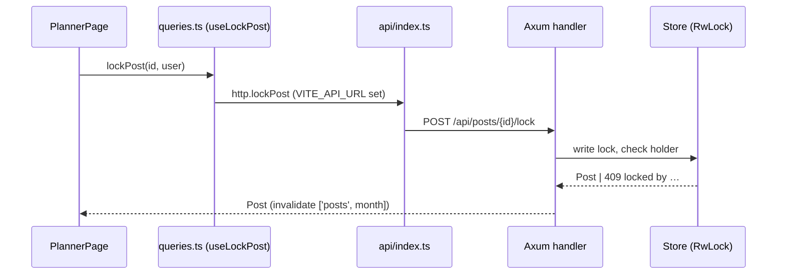

# 05 — เขียน design.md สำหรับ Huuk

> `design.md` = ภาพใหญ่ว่าระบบทำงานอย่างไร (components + interactions)
> Kiro ให้นิยามไว้ที่ https://kiro.dev/docs/specs/feature-specs/#design-documentation
> ไฟล์นี้เติมสิ่งที่ Huuk บังคับเพิ่ม

## 05.1 โครงมาตรฐาน (7 sections — ลำดับนี้เลย)

```markdown
# Design: <feature-name>
- Workflow: Requirements-First | Design-First (+ High/Low level)
- Links: requirements.md, tasks.md, openapi.yaml refs, related code paths

## 1. Context & constraints
## 2. Architecture (components + responsibilities)
## 3. Data flow (sequence diagrams)
## 4. API contract (endpoint table + openapi diff)
## 5. Permissions & modes (authRequired/demo/production matrix)
## 6. Mock/HTTP parity + state & persistence
## 7. Error handling & testing strategy
```

## 05.2 ทีละ section (เขียนอะไรบ้าง)

### 1. Context & constraints

- ปัญหาที่แก้ + non-goals (อะไร **ไม่ทำ** ในสโคปนี้ — สำคัญพอๆ กับสิ่งที่ทำ)
- Constraints: tech stack บังคับ, performance numbers, compliance,
  integration points (เช่น Meta Graph, provider credentials)
- ตัวอย่าง non-goal: "ไม่ทำ multi-instance DB ในสโคปนี้ — ยังใช้ `Arc<RwLock<Store>>`"

### 2. Architecture

- Components + responsibilities (1 ประโยคต่อ component)
- ระบุไฟล์จริงที่จะแตะ: `server/src/handlers.rs` (handler ใหม่ชื่ออะไร),
  `app/src/api/http.ts` + `app/src/mock/api.ts` (ฟังก์ชันชื่ออะไร),
  `app/src/core/queries.ts` (query keys อะไร), pages/components ใด
- ถ้าแตะ navigation: ระบุ hub/tab ใน `screens.ts` + `HUB_TABS`
  หรือ `meta.public`/`meta.standalone` ถ้านอก deck

### 3. Data flow (sequence diagrams)

ใช้ mermaid (render ใน GitHub/VS Code ได้เลย):



- วาด **happy path + 1 error path** อย่างน้อย (เช่น 409 / stale version / 401)
- ถ้ามี background loop (ads/live refresh) วาด loop แยก + ระบุ interval env

### 4. API contract (Huuk บังคับ)

ตาราง endpoint:

| Method | Path | Body/query | Returns | Permission (`x-permission`) |
|---|---|---|---|---|
| POST | `/api/posts/{id}/lock` | `{ user }` (demo only) | `Post` | `posts.lock` |

- ทุก row ต้องมี counterpart ใน `server/openapi.yaml` (path + schema + `x-permission`)
- ระบุ error codes ทุกตัว: `400/401/403/404/409` + message ตรงตัว
- JSON **camelCase**; errors `{ "error": "…" }` เสมอ
- ถ้าเป็น CMS (`/api/content*`) ระบุ `version` concurrency + `409` stale path

### 5. Permissions & modes matrix

| Mode | Reads | Writes | Notes |
|---|---|---|---|
| Demo (`DEMO_MODE=1`) | open | open, tokens optional; locks ใช้ client `user` | seeded accounts + open registration |
| Production | token ทุก `GET` ยกเว้น health/ready/public/brand-ci/oauth/docs | `Bearer` + role มี permission | demo accounts หาย, registration ปิด, Owner แรกจาก `ADMIN_EMAIL`/`ADMIN_PASSWORD` |

- ระบุ permission string ที่ใช้ (13 ตัว — ดู `server/README.md` § Permissions)
- กรณีพิเศษ: locks derive holder จาก session (client-sent ถูก ignore),
  CMS admin onboard (`users.manage`), OAuth `/start` ต้อง `platforms.manage`

### 6. Mock/HTTP parity + state & persistence

- ฟังก์ชันใหม่ต้องมี **ทั้ง** `http.ts` **และ** `mock/api.ts` (ชื่อ + signature เดียวกัน)
- ถ้ามี state ใหม่: อยู่ตรงไหนของ `Store`, seed อะไร, snapshot อย่างไร
  (atomic write ทุก 5s + SIGTERM/SIGINT — ของเดิมใช้ได้เลย ไม่ต้องออกแบบใหม่
  ยกเว้น multi-instance ซึ่งอยู่นอกสโคป)
- sessions/tokens: in-memory, reset on restart (ถ้าต้อง persist → ออกแบบ secrets
  แบบ `src/secrets.rs` ChaCha20-Poly1305)

### 7. Error handling & testing strategy

- ระบุทุก error path → status + message + UI ที่แสดง (alert role / inline error)
- Testing: test ฝั่ง server (`tests/api.rs` via oneshot) + ฝั่ง frontend
  (vitest, query ด้วย role/text/tag) — ตั้งชื่อ test ให้ trace กลับ REQ-ID
- Verification gates: `bun run build` + `bun run test` (vue-tsc จับ type errors)

## 05.3 Checklist ก่อนออกจาก Design Phase

- [ ] ทุก requirement ใน `requirements.md` มี component/endpoint รองรับ (trace ครบ)
- [ ] API table ครบ + openapi.yaml diff ร่างไว้ + permission ระบุทุก mutating row
- [ ] mock/HTTP parity วางแผนไว้ (ชื่อฟังก์ชันตรงกัน)
- [ ] sequence ครอบ happy + error paths หลัก
- [ ] demo vs production behavior ต่างกันตรงไหน ระบุชัด
- [ ] non-goals เขียนไว้ (กัน scope creep)
- [ ] testing strategy ระบุไฟล์ test + REQ trace

## 05.4 ตัวอย่างจริง

ดู `design.md` ของ landing page (public static page — design เบา เน้น routing +
i18n + styling rules): [examples/landing-page/design.md](examples/landing-page/design.md)
