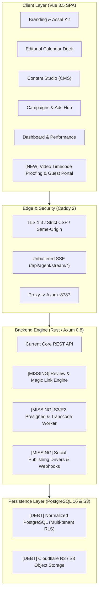
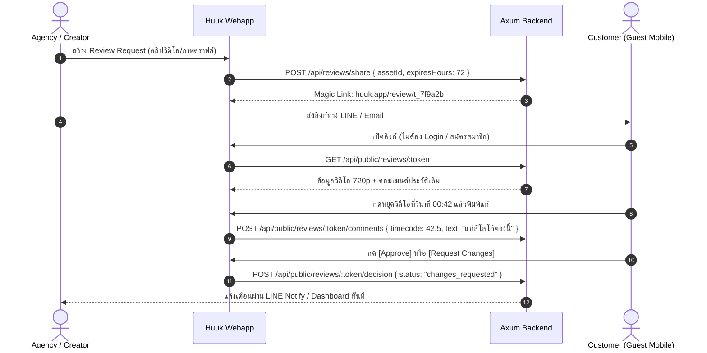

# Huuk — Complete Features Inventory & API Gap Specification

> **เอกสารแม่แบบสเปกระบบ (Consolidated Product Blueprint & Technical Gap Analysis)**  
> รวบรวมจาก: `middle.md`, `middle-agy.md`, `middle-deepseek.md`, `conclusion.md`, `bugsfound-opencode.md` และ `HUUK_USER_STORIES.md`  
> วันที่: 22 ตุลาคม 2026  
> สถานะ: **Active Blueprint for Production Execution**

---

## 1. Executive Summary & Product Architecture

Huuk กำลังยกระดับจาก **Editorial Planner UI** สู่ **Production-Ready Content Operations & Client Review Suite** สำหรับครีเอเตอร์และ Marketing Agency ในไทย



### ความจริงทางสถาปัตยกรรม (Architectural Reality):
1. **Frontend UI (100% Complete):** หน้าจอทั้ง 6 Hub (Brand, Dashboard, Plan, Content Studio, Promote, Analyze) รวมถึง Deck Card, DockBar, และ Master-Detail Selection ใช้งานได้ลื่นไหลสมบูรณ์
2. **Current Backend (Mock/State Store):** รันผ่าน In-memory RAM (`RwLock<Store>`) แล้ว Dump เป็น JSONB Blob ก้อนเดียวที่ `app_state_snapshots (id=1)` — การกด Publish, Schedule, หรือ Import Metrics ยังเป็นการเปลี่ยน Mock State เท่านั้น
3. **Missing Engine (ขาด API หลัก):** ขาด API ตรวจงานวิดีโอ (The Wedge), API จัดการมีเดียขนาดใหญ่ (Presigned S3/R2), API ยิง Social จริง (TikTok/Meta/YouTube Direct API), และ Webhook Ingress

---

## 2. Complete Features Inventory (รายการฟีเจอร์ทั้งหมดตามโมดูล)

| โมดูล | ฟีเจอร์หลัก | สถานะใน UI | สถานะ API ปัจจุบัน | สิ่งที่ต้องทำเพิ่มเพื่อให้ Production-Ready |
|---|---|:---:|:---:|---|
| **E01: Auth & Account** | Email/Password, HttpOnly Cookie, Argon2id, Session Refresh Queue, Change Password, Profile, Plan | ✅ มีแล้ว | ✅ Production-ready | ปรับให้รองรับ Multi-tenant User Mapping ข้าม Workspace |
| **E02: Workspace & RBAC** | Multi-workspace CRUD, เชิญสมาชิก, Role: Owner, Admin, Editor, Viewer | ✅ มีแล้ว | ⚠️ RAM Dump | ย้ายสิทธิ์ลง Row-Level Security (RLS) บน PostgreSQL |
| **E03: Brand Identity** | Brand Voice, Color Palette, Custom Font Upload, Logo & Moodboard Assets | ✅ มีแล้ว | ⚠️ Base64 in JSON | ย้ายการจัดเก็บไฟล์รูป/ฟอนต์ไปที่ S3/R2 และทำ Hash Caching |
| **E04: Content Planner** | Editorial Calendar 12 เดือน, Post CRUD, Locking แถวป้องกันแก้ชนกัน, Filter เดือน/ปี | ✅ มีแล้ว | ⚠️ RAM Dump | เชื่อมโยงกับระบบ Review Status และ Workflow Approval |
| **E05: Ideas & Hashtags** | Backlog ไอเดีย, Toggle เสร็จ, Promote ไอเดียเป็นโพสต์, คลังแท็ก | ✅ มีแล้ว | ⚠️ RAM Dump | เพิ่ม AI Hook & Script Generation จากไอเดีย |
| **E06: Performance & Finance** | Dashboard กราฟการเติบโต, บันทึกรายรับรายจ่าย (Txns), นำเข้าสถิติ | ✅ มีแล้ว | ❌ Pseudo-Import | ต่อ API ดึง Real Platform Insights จาก Meta/TikTok/YT |
| **E07: Campaigns & Ads** | ติดตาม Campaign Deliverables, Meta Ads Mirror, Pause/Budget/Boost | ✅ มีแล้ว | ⚠️ Mock/Mirror | เพิ่ม TikTok Campaign Mirror และ Attribution ROAS จริง |
| **E08: Platform Connections** | เชื่อมต่อโซเชียล, OAuth 2.0 Credential-optional, Facebook/IG Page Pick | ✅ มีแล้ว | ⚠️ Partial Meta | เพิ่ม Driver สำหรับ TikTok Login Kit & YouTube OAuth |
| **E10: Content Studio (CMS)** | Markdown Editor, Revisions History, Restore, Optimistic Concurrency | ✅ มีแล้ว | ⚠️ Local State | รองรับ Rich Media Attachments, Carousel Slide Builder |
| **E12: Public Delivery** | Public Reader ของคอนเทนต์ที่เผยแพร่ (`/api/public/content/:slug`) | ✅ มีแล้ว | ✅ มีแล้ว | Cache Invalidation ด้วย Tag/CDN |
| **NEW: The Killer Wedge** | Video Timecode Proofing, Visual Diff Slider, Guest Magic Link Portal | ❌ ยังไม่มี | ❌ ยังไม่มี | **ต้องสร้างใหม่ทั้งหมด (P0 Wedge)** |
| **NEW: Media Pipeline** | Direct-to-S3 Upload, Video Proxy Transcoding, Thumbnail Generator | ❌ ยังไม่มี | ❌ ยังไม่มี | **ต้องสร้างใหม่ทั้งหมด (P0 Media)** |

---

## 3. Detailed API Gap Analysis (ตารางเปรียบเทียบ API ขาด)

### หมวด 3.1: The Killer Wedge (Client Review & Proofing Hub) — **Priority: P0**
นี่คือหมวดฟีเจอร์หลักที่จะทำให้ Agency และทีมการตลาดเลือกใช้ Huuk แทน Google Drive / Notion



| Method | Endpoint | คำอธิบาย & Payload | สถานะปัจจุบัน | สิ่งที่ต้องสร้าง |
|---|---|---|:---:|---|
| `POST` | `/api/reviews/share` | สร้าง Magic Link ตรวจงานแบบมีอายุ:<br>`{ assetId: "...", expiresHours: 72, allowDownload: false }` | ❌ ขาด | สร้าง SHA-256 Hashed Token, ตรวจจับวันหมดอายุ (TTL), จำกัดสิทธิ์เฉพาะชิ้นงานที่ส่ง |
| `GET` | `/api/public/reviews/:token` | ดึงข้อมูลชิ้นงานสำหรับ Guest Portal (ไม่ต้องมี Auth Header) | ❌ ขาด | Endpoint ส่งคืน Video Stream URL, Image Diffs, และรายการคอมเมนต์ที่เคยคุยกัน |
| `POST` | `/api/public/reviews/:token/comments` | เพิ่มคอมเมนต์ผูกกับ Timecode:<br>`{ timecode: 42.5, text: "แก้เสียงพูด", authorName: "คุณปุ๊ก (ลูกค้า)" }` | ❌ ขาด | รองรับการ Reply เป็น Thread และ Timestamp ระดับมิลลิวินาที |
| `POST` | `/api/public/reviews/:token/decision` | บันทึกการตัดสินใจของลูกค้า:<br>`{ decision: "approved" \| "changes_requested", note: "..." }` | ❌ ขาด | อัปเดต Status ในปฏิทิน Planner และส่ง Webhook/Notification กลับหาทีม |
| `GET` | `/api/reviews/assets/:id/diff` | ดึงข้อมูลภาพเปรียบเทียบ Draft 1 vs Draft 2 สำหรับ Visual Diff Slider | ❌ ขาด | คำนวณ Aspect Ratio และส่ง Pair Images สำหรับ Slider Overlay |

---

### หมวด 3.2: Media Asset Pipeline & Direct Upload — **Priority: P0**
แก้ปัญหาไฟล์วิดีโอขนาดใหญ่ (MP4/MOV สำหรับ TikTok & Reels) ซึ่งไม่สามารถส่งผ่าน JSON Base64 ได้

| Method | Endpoint | คำอธิบาย & Payload | สถานะปัจจุบัน | สิ่งที่ต้องสร้าง |
|---|---|---|:---:|---|
| `POST` | `/api/media/upload-url` | ขอ Presigned URL เพื่ออัปโหลดตรงไปยัง S3/Cloudflare R2:<br>`{ filename: "reel.mp4", mimeType: "video/mp4", sizeBytes: 15482910 }` | ❌ ขาด | สร้าง AWS SigV4 Presigned PUT URL แยกโฟลเดอร์ตาม `/{workspace_id}/{uuid}` |
| `POST` | `/api/media/confirm` | ยืนยันว่าอัปโหลดเข้า S3 เรียบร้อย เพื่อเริ่มกระบวนการสกัด Metadata | ❌ ขาด | ตรวจสอบ HeadObject บน S3 บันทึกลงตาราง `assets` |
| `POST` | `/api/media/transcode-webhook` | รับ Event จาก Video Worker เมื่อแปลงคลิป 720p Proxy เสร็จสิ้น | ❌ ขาด | อัปเดต URL `proxy_url` และ `duration_seconds` สำหรับเปิดดูบนเว็บเร็ว |
| `POST` | `/api/media/thumbnail` | สกัดหรือเลือกภาพปก (Cover Thumbnail) จากวินาทีที่ต้องการ | ❌ ขาด | สั่งรัน FFmpeg Worker สกัดภาพ JPEG ขนาด 1080x1920 จากไทม์โค้ด |

---

### หมวด 3.3: Social Auto-Publishing & Real Drivers — **Priority: P1**
เปลี่ยนปุ่ม Publish & Schedule ในระบบให้ยิงเข้าแพลตฟอร์มโซเชียลมีเดียจริง

| แพลตฟอร์ม | Target Endpoint | รูปแบบการเชื่อมต่อ (Integration Driver) | สถานะปัจจุบัน |
|---|---|---|:---:|
| **Meta (Facebook/IG)** | `POST /api/publish/meta/:id` | Facebook Graph API (`/photos`, `/videos`, `/feed`) + Instagram Graph API (`/media_publish` สำหรับ Reels & Carousel) | ⚠️ มีแค่ Mock State |
| **TikTok** | `POST /api/publish/tiktok/:id` | TikTok Content Posting API v2 (`/v2/post/publish/video/init/`) รองรับ Direct Post & Creator Inbox | ❌ ยังไม่มี |
| **YouTube** | `POST /api/publish/youtube/:id` | YouTube Data API v3 (`videos.insert`) พร้อมการตั้งค่า Shorts category, tags และ privacy status | ❌ ยังไม่มี |
| **Line VOOM** | `POST /api/publish/line/:id` | Line Messaging API / Social API สำหรับโพสต์ไทม์ไลน์ | ❌ ยังไม่มี |
| **Webhooks Ingress** | `POST /api/webhooks/:provider` | Endpoint ตรวจสอบ HMAC Signature รับสถานะ Post Success / Failed / Comment Event | ❌ ยังไม่มี |

---

### หมวด 3.4: Real Analytics & Performance Tracking — **Priority: P1**
เปลี่ยนจากการสุ่มตัวเลข Pseudo-Import มาเป็นการดึงสถิติจริงผ่าน API

| Method | Endpoint | คำอธิบาย | สถานะปัจจุบัน |
|---|---|---|:---:|
| `POST` | `/api/metrics/sync/:platform` | ยิงดึงสถิติย้อนหลัง 30 วัน (Reach, Impressions, Likes, Comments, Shares, Watch Time) จาก Platform API จริง | ❌ ปัจจุบันสุ่มตัวเลข |
| `GET` | `/api/metrics/benchmarks` | เปรียบเทียบประสิทธิภาพของ Content Format (Reels vs Carousel vs Static Image) เพื่อแนะนำเวลาและประเภทที่ดีที่สุด | ❌ ขาด |
| `POST` | `/api/posts/:id/post-mortem` | บันทึก Qualitative Notes (เช่น โพสต์นี้ปังเพราะกระแสข่าว X) เพื่อใช้เป็นความรู้ของทีม | ❌ ขาด |

---

### หมวด 3.5: AI Content Operations & Copilot — **Priority: P2**
เปิดใช้งาน Reverse Proxy `/api/agent/stream/*` ที่เตรียมไว้ใน `Caddyfile` ให้มี Backend Handler รองรับ

| Method | Endpoint | คำอธิบาย | สถานะปัจจุบัน |
|---|---|---|:---:|
| `POST` | `/api/agent/stream/hook` | Unbuffered Server-Sent Events (SSE) สร้าง 10 ไอเดีย Hook 3 วินาทีแรกตามกลุ่มเป้าหมาย | ⚠️ มีแค่ Caddy route |
| `POST` | `/api/agent/stream/script` | สร้างโครงร่างสคริปต์วิดีโอ (Hook → Story → Call to Action) แบ่งจังหวะเวลาเป็นวินาที | ❌ ขาด |
| `POST` | `/api/agent/stream/repurpose` | แปลง Markdown บทความยาวจาก Content Studio ให้กลายเป็น 5 Social Captions | ❌ ขาด |
| `POST` | `/api/agent/check-policy` | ตรวจสอบคำต้องห้าม กฎหมายโฆษณา และความสอดคล้องกับ Brand Do's & Don'ts | ❌ ขาด |

---

## 4. Technical Debt & Critical Architecture Fixes (หนี้ทางเทคนิควิกฤต)

ตามรายงานใน [bugsfound-opencode.md](file:///home/aslpooht/PROJECT/_TEENUENG-COMPANY/PRODUCTIVITY-prod/bugsfound-opencode.md) ระบบมี 5 ปัญหาเชิงสถาปัตยกรรมที่ต้องได้รับการ Refactor:

```
┌─────────────────────────────────────────────────────────────────────────────┐
│ BUG-01: ยกเลิก app_state_snapshots (JSONB blob ที่ id=1)                     │
│ ปัญหา: รันบน RAM แล้วเซฟทับ JSON ก้อนเดียว ทำให้ Scale ไม่ได้และไม่ใช่ RLS  │
│ แก้ไข: แตกเป็นตาราง Normalized PostgreSQL พร้อม Foreign Key workspace_id    │
├─────────────────────────────────────────────────────────────────────────────┤
│ BUG-02: ปิดช่องโหว่ Asset ข้าม Tenant & ย้ายไป Object Storage               │
│ ปัญหา: เก็บรูปบน Local Disk ในโฟลเดอร์รวม และเปิดอ่านแบบ Public ไร้สิทธิ์   │
│ แก้ไข: ย้ายไป Cloudflare R2 / S3 แยก Prefix /{workspace_id}/{asset_uuid}    │
├─────────────────────────────────────────────────────────────────────────────┤
│ BUG-03: ยุบการแยกส่วน Pugu ↔ Huuk Disconnect                                │
│ ปัญหา: 2 แอปแยก Session กัน ผู้ใช้ต้องล็อกอินสองรอบ                          │
│ แก้ไข: ผสาน Auth สู่ Unified SSO และนำเข้า Sheet/Calc เป็น Tab ใน Huuk      │
├─────────────────────────────────────────────────────────────────────────────┤
│ BUG-04: เลิกใช้ Base64 Upload ใน JSON Payload                               │
│ ปัญหา: ส่ง Base64 ใน Body ทำให้ Memory RAM บวมและบล็อก Tokio Thread         │
│ แก้ไข: ใช้ Presigned Direct S3 Upload หรือ Streaming Multipart             │
├─────────────────────────────────────────────────────────────────────────────┤
│ BUG-05: แก้ไข Cache Invalidation Void                                       │
│ ปัญหา: ตั้ง Cache immutable 1 ปี แต่ชื่อไฟล์ไม่มี Content Hash              │
│ แก้ไข: ทำ Content Addressing (เช่น logo.c8a2b1.png) ก่อนใส่ Header          │
└─────────────────────────────────────────────────────────────────────────────┘
```

---

## 5. แผนการพัฒนา 90 วัน (Action Plan & Phasing)

### สัปดาห์ 1–4 (Phase 1: The Wedge & Media Engine)
* [ ] พัฒนา **Media Presigned Upload API** (`/api/media/upload-url`) เชื่อมกับ Cloudflare R2 / S3
* [ ] สร้างโมดูล **Review Hub & Video Timecode Proofing API** ใน Rust Axum
* [ ] พัฒนาหน้าจอ **Guest Review Portal** (Mobile-friendly, Magic Link, Approve/Request Changes)
* [ ] เพิ่มฟังก์ชัน Visual Diff Slider บน Vue 3

### สัปดาห์ 5–8 (Phase 2: Database Normalization & Security)
* [ ] ย้าย Data Model จาก In-Memory Dump สู่ Normalized PostgreSQL Tables
* [ ] เปิดใช้งาน Row-Level Security (RLS) เพื่อการันตีความปลอดภัยข้าม Workspace
* [ ] สร้าง Audit Log สำหรับบันทึกประวัติการส่งตรวจงานและการแก้งาน
* [ ] ทำ Video Proxy Transcoder Worker (แปลง 720p H.264 อัตโนมัติ)

### สัปดาห์ 9–12 (Phase 3: Social Automation, Analytics & AI)
* [ ] เชื่อมต่อ Meta & TikTok Direct Publishing Drivers
* [ ] พัฒนา Real Metrics Sync API
* [ ] เปิดใช้งาน AI Streaming Endpoint (`/api/agent/stream/*`) ร่วมกับ Caddy
* [ ] นำร่องทดสอบระบบกับ **10 Marketing Agencies ในไทย**

---

> **สรุปการส่งมอบ**: เอกสารชุดนี้ถูกจัดเก็บถาวรไว้ที่ [`huuk/docs/API_GAP_AND_FEATURES_ROADMAP.md`](file:///home/aslpooht/PROJECT/_TEENUENG-COMPANY/PRODUCTIVITY-prod/huuk/docs/API_GAP_AND_FEATURES_ROADMAP.md) เพื่อใช้เป็นพิมพ์เขียวหลักในการ Implement ฟีเจอร์และ API ถัดไปทั้งหมดครับ
