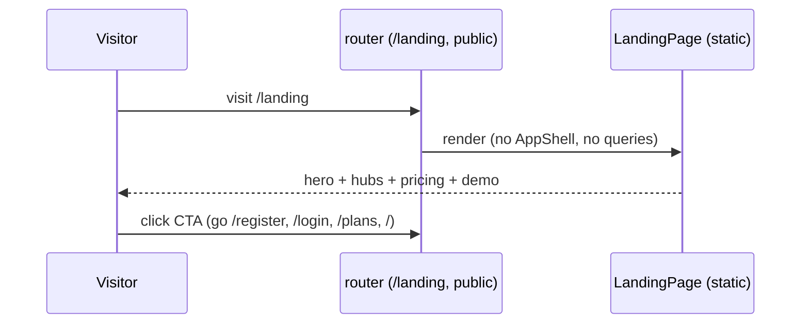

# design.md — EXAMPLE: Landing Page (`/landing`)

- Feature: public marketing landing | Workflow: Requirements-First
- Links: `requirements.md`, `tasks.md`
- Chrome: ported from teenueng portfolio design system
  (`/home/aslpooht/PROJECT/_TEENUENG-COMPANY/portfolio/design.md`) —
  strict monochrome ink/paper, Tinos 700 display + Inter UI, square corners,
  hard-step hover shadows (`app/src/pages/landing.css` keeps its own chrome
  like PlatformLogin, outside the app theme)

## 1. Context & constraints

- Problem: Huuk ไม่มี marketing entry — visitor จากภายนอกไม่มีหน้า overview
  ก่อนตัดสินใจ try/demo; ของเดิมมีแค่ `/plans` (pricing) กับ `/login`
- Non-goals: ไม่ย้าย `/`, ไม่ทำ i18n ไทย, ไม่แตะ backend (static only)
- Constraints: ต้องตาม frontend rules (00 §00.8): no `<style>`,
  rounded-none/rounded-full, border มีสี, button มี w-full|w-auto,
  import ผ่าน `@`, tests query role/text/tag

## 2. Architecture

| Component | Responsibility | Files |
|---|---|---|
| `LandingPage.vue` | static sections + CTAs + `go()` via router | `app/src/pages/LandingPage.vue` (ใหม่) |
| i18n keys | copy อังกฤษทั้งหมด (`landing.*` ~30 keys) | `app/src/core/i18n.ts` (เติม) |
| route | `/landing` → component, `meta.public` | `app/src/app/router/index.ts` (2 จุด: import + route) |
| tests | 4 tests (hero, hubs, pricing+demo, links) | `app/src/tests/landing.test.ts` (ใหม่) |

- Navigation: นอก deck (`meta.public` → `App.vue` render `RouterView` ตรง,
  ไม่ผ่าน AppShell/ScreensDeck); ไม่ต้องแตะ `screens.ts`/`HUB_TABS`
- ทำไม static: ไม่มี queries → ไม่ต้องมี QueryClient ใน test, ไม่มี loading states

## 3. Data flow

- Error paths: ไม่มี (static) — มีแค่ router guard เดิม:
  signed-in users โดนกันออก `/login`/`/register` (พฤติกรรมเดิม ไม่ต้องแก้)

## 4. API contract

- ไม่มี (ไม่มี endpoint ใหม่ → 4-place rule ไม่เกี่ยว, openapi.yaml ไม่แตะ)

## 5. Permissions & modes

- Public ทั้ง demo/production (เหมือน `/plans`): ไม่ต้องมี token
- Header ต่างกันแค่ `loggedIn` (currentUser): login link vs back-to-app link

## 6. Mock/HTTP parity + state & persistence

- ไม่มี (static page ไม่เรียก api → ไม่ต้องเติม http.ts/mock)

## 7. Error handling & testing strategy

| Path | Assert |
|---|---|
| hero | `h1` มี "Plan content", 3 buttons (Start free/Open workspace/See packages) |
| hubs | `h3` ครบ 6 ชื่อ |
| pricing+demo | text มี Free/Pro/Business + 3 demo emails + `demo1234` |
| links | `a[href]` ครอบ `/login`, `/plans`, `/read` |

- Tests: `cd app && bun run test -- landing` (4 passed)
- Gates: `bun run typecheck` ✅ (vue-tsc clean)
