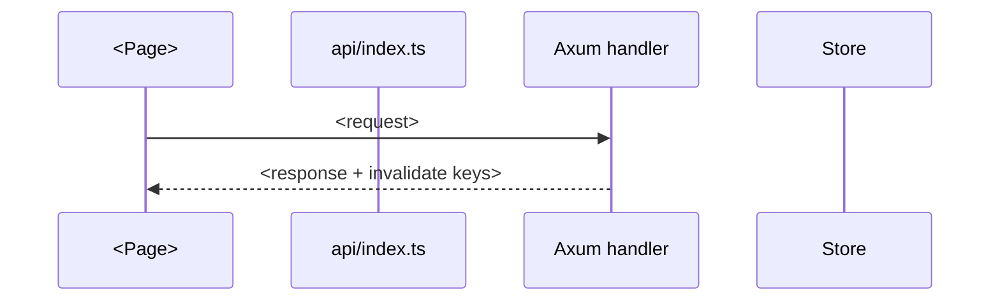

# design.md — TEMPLATE

> วิธีเขียนดู `docs/05-design-doc.md` — ลำดับ 7 sections นี้เลย

- Feature: `<name>` | Workflow: `<…>` | Links: `requirements.md`, `tasks.md`

## 1. Context & constraints

- Problem: `<…>` | Non-goals: `<…>` | Constraints: `<stack/perf/compliance/integrations>`

## 2. Architecture (components + responsibilities)

| Component | Responsibility | Files touched |
|---|---|---|
| `<…>` | `<1 ประโยค>` | `<paths จริง>` |

- Navigation: hub/tab ใดใน `screens.ts` + `HUB_TABS` (หรือ `meta.public`/`standalone` ถ้านอก deck)

## 3. Data flow (sequence diagrams)

- Happy path + ≥1 error path (409/401/stale version/…)

## 4. API contract

| Method | Path | Body/query | Returns | Permission (`x-permission`) |
|---|---|---|---|---|
| `<…>` | `<…>` | `<…>` | `<…>` | `<…>` |

- openapi.yaml diff (path + schema + errors): `<…>`
- JSON camelCase; errors `{ "error": "…" }`; CMS `version` + 409 ถ้าเกี่ยว

## 5. Permissions & modes

| Mode | Reads | Writes | Notes |
|---|---|---|---|
| Demo | `<…>` | `<…>` | `<…>` |
| Production | `<…>` | `<…>` | `<…>` |

## 6. Mock/HTTP parity + state & persistence

- ฟังก์ชันใหม่ทั้ง `http.ts` + `mock/api.ts` (ชื่อ/signature): `<…>`
- State/seed/snapshot: `<…>` (default: Store เดิม + atomic snapshot)

## 7. Error handling & testing strategy

| Error path | Status + message | UI |
|---|---|---|
| `<…>` | `<…>` | `<…>` |

- Tests: `server/tests/api.rs` (`<filter>`) + `app/src/tests/<…>.test.ts` (query role/text/tag)
- Gates: `bun run build` + `bun run test`
